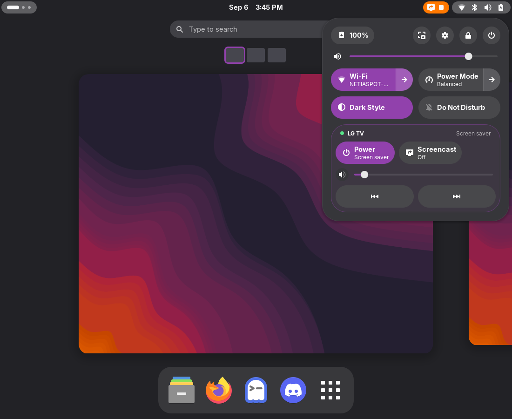
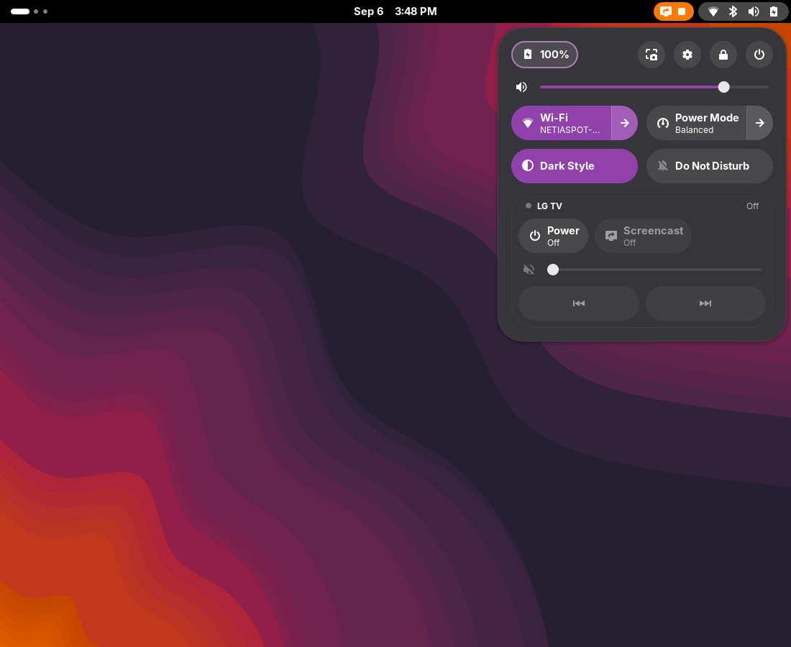

# LG TV Remote

A remote for a rooted LG webOS TV, living in the GNOME Quick Settings panel:
power, volume, track skip and screen streaming — in the same place as Wi-Fi and
Dark Style, styled by the same theme.

| TV awake | TV off or off the network |
|---|---|
|  |  |

When the TV is unreachable the group dims but stays put, and the power tile
stays live — that is the one state in which you actually reach for a remote.

Tested on Fedora 44, GNOME Shell 50.4, Wayland.

## How it works

```
GNOME Shell extension  ──D-Bus──▶  lgtvd  ──ssh──▶  the TV
   (drawing only)                (all the waiting)
```

The split is the point. GJS in the shell is single-threaded, and turning the TV
on can take 90 seconds. If the extension did that work itself it would freeze
the whole desktop — clock, window switching and all. So the service absorbs the
latency, holds one persistent SSH connection, and the shell only ever reads a
value that is already known.

That single connection is also why the volume slider feels immediate: opening a
fresh SSH session costs ~150 ms, sending a command down an open one costs ~30.

## Requirements

- GNOME Shell 49 or 50 on Wayland
- Python 3.11+ and PyGObject (`sudo dnf install python3-gobject-base`) — nothing else
- A rooted LG webOS TV reachable over SSH as `root`, with an entry in `~/.ssh/config`
- Wake-on-LAN enabled on the TV (*Settings → Support → IP Control Settings*), for powering on
- Optional, for the screencast tile: Sunshine on this machine, Moonlight on the TV

## Install

```sh
git clone https://github.com/maniumek/lgtv-remote-widget ~/repos/lgtv-remote-widget
cd ~/repos/lgtv-remote-widget
cp setup.cfg.example setup.cfg     # fill in host, MAC and broadcast address
./setup.sh
```

Then log out and back in. Wayland cannot reload GNOME Shell in place, so there
is no way around it.

`setup.sh` is idempotent, needs no root, and never overwrites an existing
configuration — if one is already there it says which settings the new release
added and leaves your file alone. If you have not filled in `setup.cfg`, it
starts from the template and seeds the host, MAC and broadcast address from
`~/scripts/lgtv/lgtv.env` when that file exists.

To try it without logging out:

```sh
dbus-run-session -- gnome-shell --nested --wayland
```

## Where things live

Standard XDG locations — nothing is read from the repository at runtime.

| What | Where |
|---|---|
| Settings | `~/.config/lgtv-remote/config.ini` (mode 0600) |
| Logs | `~/.local/state/lgtv-remote/{actions,errors}.log` |
| Extension | `~/.local/share/gnome-shell/extensions/lgtv-remote@maniumek` → this repo |
| Service | `~/.config/systemd/user/lgtv-remote.service` |
| SSH control socket | `$XDG_RUNTIME_DIR/lgtv-remote/` |

Settings are resolved weakest to strongest: built-in defaults →
`/etc/xdg/lgtv-remote/config.ini` → your file → environment variables → command
line. So a one-off override needs no editing at all:

```sh
LGTV_HOST=other-tv ./bin/lgtvd
```

## Everyday use

```sh
systemctl --user status lgtv-remote      # is it running
journalctl --user -u lgtv-remote -f      # what is it doing
tail -f ~/.local/state/lgtv-remote/actions.log
```

`actions.log` gets one line per action, meant to be read by eye:

```
2026-09-06T15:31:29+0200 action=media_key key=next code=208 result=ok duration=0.2s
```

Everything the widget can do is also reachable from a terminal — see
[docs/dbus-api.md](docs/dbus-api.md).

## Uninstall

```sh
./uninstall.sh --dry-run    # show what would happen
./uninstall.sh              # remove the installation, keep settings and logs
./uninstall.sh --purge      # remove everything
```

## Notes on the TV itself

The awkward parts of webOS — why `luna-send` needs `< /dev/null`, why only one
of seven input devices actually delivers key presses, why there is no
next-track key — are written down in [docs/webos-notes.md](docs/webos-notes.md),
along with how each was measured.

## Layout

```
bin/lgtvd                 run the service straight from the repository
src/lgtvd/                the service
  ssh.py                  one shared SSH connection
  luna.py                 calling webOS services, with the traps handled
  tv.py power.py cast.py keys.py    what the TV can be asked to do
  daemon.py worker.py     state model and the single command queue
  dbus.py                 the session-bus interface
extension/                the GNOME Shell extension (drawing only)
systemd/                  the user service template
docs/                     D-Bus interface and measured TV behaviour
tests/                    unit tests for the parts that need no TV
```
